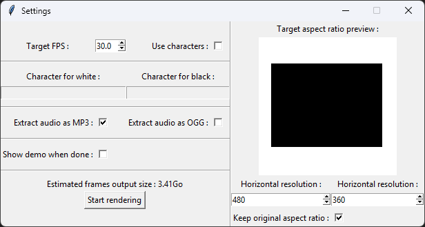
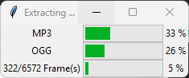
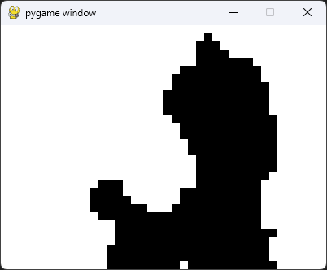
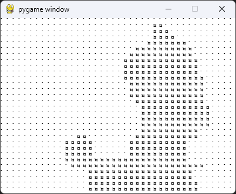
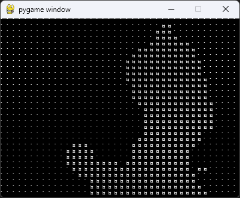

# bad-apple-data-extractor

An python app that extract a JSON array containing black and white frames from any given video file.
It can also extract an MP3 and / or an OGG file.
Once extracted, a demo can be played.
This app was made to be used on [“【東方】Bad Apple!! ＰＶ【影絵】” by kasidid2 on Youtube](https://www.youtube.com/watch?v=FtutLA63Cp8).

## Features

- A settings GUI with :
    - FPS control
    - Posibility to use characters (one for black and one for white)
    - Audio output selection
    - Frames settings (width and height, with a 'keep ratio' toggle)
    - Target aspect ratio preview
    - Frames file size preview (to avoid bad surprises)
    - Demo toggle
    - see [The settings GUI](#the-settings-gui)
- A loading GUI giving a progress status :
    - see [The progress GUI](#the-progress-gui)
- A demo player whith basic playback controls :
    - see [The demo](#the-demo), [Demo playback controls](#demo-playback-controls)

## Installation

Before running this project, you must install its requirements.

1) You will need to have `FFmpeg` on your system.

To do this you can grab it from [the official links](https://www.ffmpeg.org/download.html) or from your package manager.

2) The others prerequisites are python packages (see [`requirements.txt`](./requirements.txt)) and I strongly recommend you to create a [venv](https://docs.python.org/3/library/venv.html) before getting them.

Once you have activated your venv (or not), in the same console you used to launch it, go to the root of this project and run this command to install the dependencies: `pip install -r requirements.txt`

## Usage/Examples

Once every requirements is satisfied, put your input video in [`input/`](./input/)  (see [`input/README.md`](./input/README.md) for details). Then simply run the file [`bad-apple-data-extractor.py`](./bad-apple-data-extractor.py) from the venv you installed (or not, once again). When the demo starts or the program exits, you can find the output files in [`output/`](./output/).

**Note :** A small wait time is normal when all the progress bars are full / almost full and between the moment the progress GUI closes and the demo opens.

When the program ends, you will find a folder named "tmp/" containing progress logs; you can delete it safely if you want, as it will be created again if you restart the program.

### Demo playback controls
**[SPACE] / [RETURN]** > Pause / unpause the demo\
**[R]** > **R**estart the demo\
**[I]** > **I**nvert the colors (sometimes helps with visibility)\
**[ARROW_UP]** > Increase the audio volume if audio is playing\
**[ARROW_DOWN]** > Decrease the audio volume if audio is playing\
**[Q] / [ESCAPE]** > **Q**uit the program

### Screenshots
#### The settings GUI

#### The progress GUI

#### The demo
|With binary values (booleans)|With characters|With characters and inverted colors|
|-----------------------------|---------------|-----------------------------------|
||||

## Contributing

This project, while not being as clean as I would like, is considered finished ...

... but if you would really like to see a new feature being added, feel free to contribute or open an issue.

See [`CONTRIBUTING.md`](./CONTRIBUTING.md) for ways to get started.

Please adhere to this project's code of conduct.

## Acknowledgements

- [The FFmpeg multimedia framework](https://www.ffmpeg.org/)
- [ffmpeg-python by @kkroening](https://github.com/kkroening/ffmpeg-python)
- [Readme editor at readme.so](https://readme.so)
- [“【東方】Bad Apple!! ＰＶ【影絵】” by kasidid2 on Youtube](https://www.youtube.com/watch?v=FtutLA63Cp8)

I do not claim ownership of third-party assets, libraries, or resources used in this project. All rights belong to their respective authors and creators.

## Authors

- [@Naexys](https://www.github.com/Naexys)